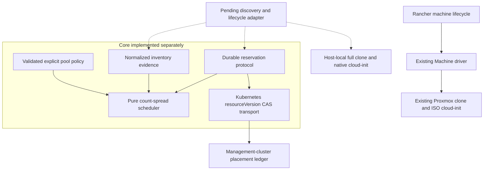

# Placement architecture

## Implementation status

`internal/placement` is an independent, executable placement/coordination core.
It is **not wired into the Machine driver**. Existing CLI, UI and provisioning
behavior are unchanged; there is no usable advanced placement switch yet.
The revised plan permits a Helm-installed authorization controller, but no such
controller or central host-reserve policy is implemented yet.

## Module boundary

- `Policy.Validate` and `Fingerprint`: explicit pool identity, allowed hosts,
  common allowed storage IDs, unique per-host template VMIDs, canonical contract.
- `Select`: no transport or side effects. Returns ordered eligible host/storage
  candidates, exclusion categories and remaining resource calculations.
- `Coordinator.Reserve`: obtains fresh evidence after each CAS conflict, then
  atomically commits resource placement, VMID claim and machine intent.
- `Coordinator.BeginSubmission`: exactly one successful caller receives a clone
  submission authorization. A response-loss case is blocked, not repeated.
- `Coordinator.RecordTask`: records a known task ID without releasing capacity.
- `KubernetesStore`: HTTPS GET/PUT of one administrator-created custom resource;
  preserves metadata and checks resourceVersion, pinned object UID and response
  contents. No API client dependency or permanent controller is introduced.

## Evidence is an explicit prerequisite

`Node`, `Storage` and `Snapshot` are normalized domain evidence, **not invented
Proxmox API fields**. A future adapter must prove template/bridge compatibility,
complete allocation and permission coverage, freshness, all-volume capacities,
and unique VM ownership. Setting a boolean without checking these is not valid
discovery. `/cluster/resources` alone does not fulfill this contract.

Discovery must include all CPU/memory allocations (including stopped guests and
containers) and full virtual storage commitments, not just this pool's VMs.
Spread counts are pool-specific. An observed owned VM replaces its pending
reservation in counts; only any still-unobserved resource delta stays reserved.
Observed migration follows the VM's current host and storage.

## Integration gates still open

No live Proxmox discovery, clone submission, native cloud-init, identity-checked
cleanup, task reconciliation or Rancher credential injection uses the new core
yet. Until these gates are tested, neither production readiness nor safe
replacement nor end-to-end correctness is claimed. The legacy driver retains
the limitations listed in the source audit.

The agreed first-release lookup relies on Rancher-generated name plus recorded
VMID and operator naming/rename constraints, not a unique VM ownership marker.
This is weaker than unique incarnation proof if both name and VMID are reused;
ambiguous cases require operator recovery. Existing core ownership fields are
not yet a verified end-to-end identity integration.
