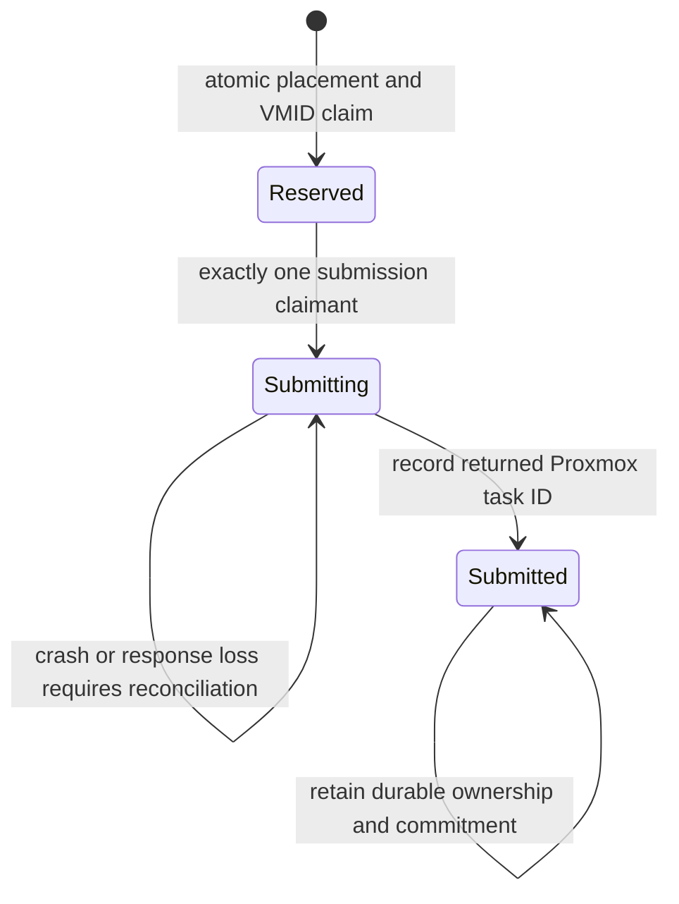

# Durable placement coordination

## Current scope

`internal/placement` implements the reservation/submission core and Kubernetes
CAS transport. It does not yet drive live VM operations. A process-local test
store is used in unit tests only; it is not a deployment option.

One ledger holds a Proxmox cluster's group-policy fingerprints, machine
incarnations, VMID claims, resource reservations and task-submission states.
Kubernetes updates use `metadata.resourceVersion`; a stale update must receive
409 and repeat discovery and selection against the new ledger. Only explicit
revision conflicts are retried, with a bounded attempt count.

There is intentionally no timer-driven transition back to free capacity.
The current core has no retirement/deletion API. Safe terminal reconciliation,
record compaction and lifecycle integration remain required before deployment.

## Important guarantees and limits

- Same intent replays return its original reservation. Changed ownership,
  resources, VMID or group policy are rejected.
- Independently instantiated coordinators share atomic storage, not a local
  scheduler counter. Pending reservations influence subsequent decisions.
- A lost reserve response may leave a reservation; retry can recover it.
- A lost submission-claim response **must not submit a clone**. The resulting
  uncertain state remains occupied rather than granting a second claimant.
- Submission tokens are not fencing tokens honored by Proxmox. Kubernetes and
  Proxmox do not share a transaction. Do not retry a side effect merely because
  its client timed out or disappeared.
- Storage accounting is host-local. An ownership-verified visible VM is not
  counted twice; partially applied hardware retains its outstanding delta.
- External creators can still race VMID allocation. The pending live adapter
  must check all occupied IDs, use an explicit reserved VMID and distinguish
  definitive conflicts from ambiguous submissions.
- External migrations/resource changes are not serialized by this ledger.
  Conflicting external operations must be excluded during provisioning.

## Kubernetes transport

The administrator must create the custom resource in the management cluster.
The transport will not recreate a missing object. Its expected object UID is
explicitly pinned so deleting/recreating the ledger does not silently reset
coordination. Unknown schema, deletion in progress, mismatched identity,
malformed/oversized responses or mutated update responses fail closed.
Requests have ten-second deadlines, require an HTTPS endpoint and do not follow
redirects. Credentials and API response bodies are not included in errors.
The HTTP client supplied by the eventual deployment adapter must verify TLS.

Defensive bounds are currently 256 records/groups, 512 KiB serialized ledger,
and 1 MiB entire HTTP object. These are implementation guards, **not a tested
production scale qualification**. A full ledger blocks further admission.

## Restore and operational recovery

Backup restoration can restore stale state while newer Proxmox operations still
exist. UID pinning does not detect an in-place historical rollback. Provisioning
must be blocked during restore and until all VMIDs, ownership and in-flight
tasks are reconciled. A complete recovery command and validated compaction
procedure are not implemented yet. Do not manually delete records to unblock
capacity or treat a lease expiry as proof of clone failure.
